<!-- Arquivo gerado pelo readme-kit. Não edite aqui: altere docs/readme/ e rode "readme-kit build". -->
<div align="center">


<br />

<a href="https://dn-fitlog.vercel.app"></a>
<a href="https://github.com/diegonatalo/fitlog">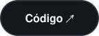</a>

<br />


</div>

<br />

<div align="center">

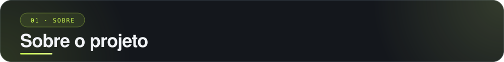

</div>

**O diário de treino que cabe no bolso.**<br />
Registre séries, monte treinos, bata recordes, estime o gasto do cardio e veja sua evolução, com tudo salvo na sua conta e disponível em qualquer aparelho.

<br />

<div align="center">

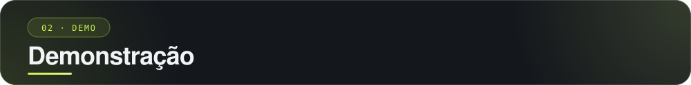

</div>

<div align="center">

<table>
  <tr>
    <td align="center" width="33%">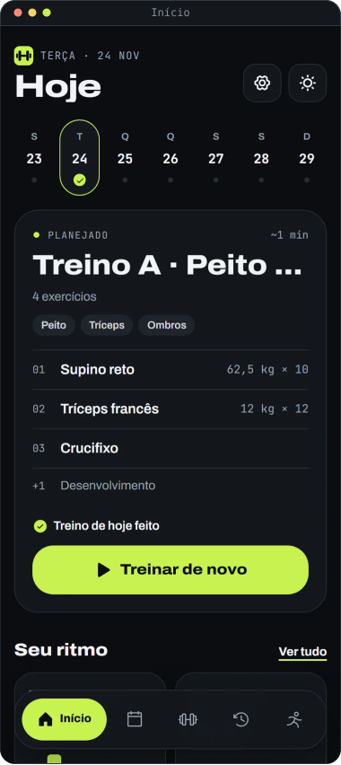<br />
      <sub><b>Início</b></sub></td>
    <td align="center" width="33%">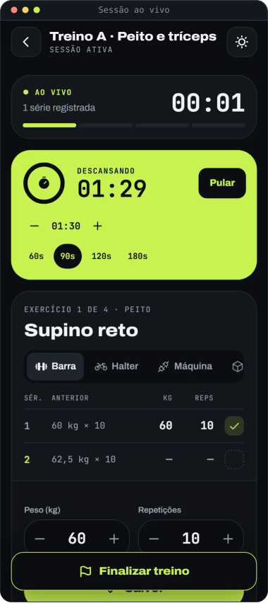<br />
      <sub><b>Sessão ao vivo</b></sub></td>
    <td align="center" width="33%">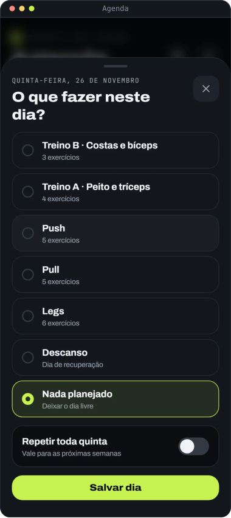<br />
      <sub><b>Agenda</b></sub></td>
  </tr>
  <tr>
    <td align="center" width="33%">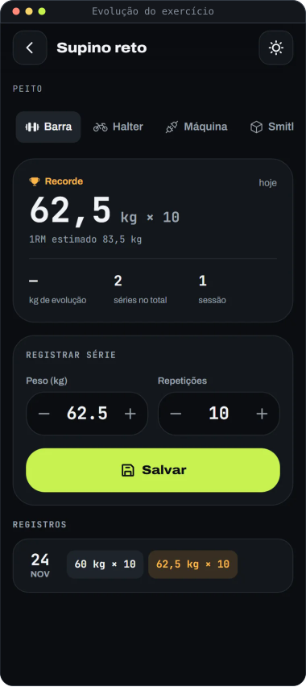<br />
      <sub><b>Evolução do exercício</b></sub></td>
    <td align="center" width="33%">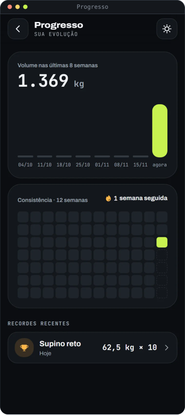<br />
      <sub><b>Progresso</b></sub></td>
    <td align="center" width="33%">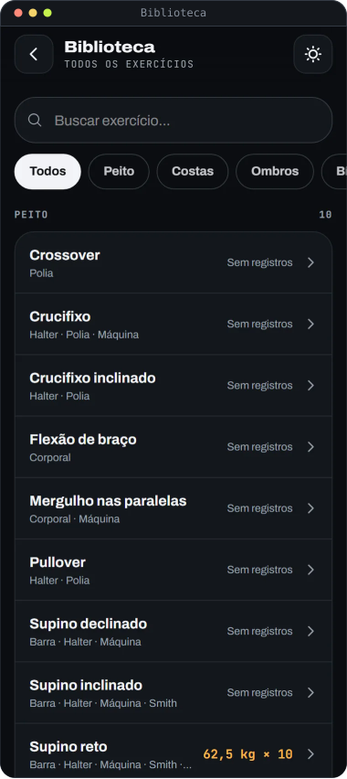<br />
      <sub><b>Biblioteca</b></sub></td>
  </tr>
  <tr>
    <td align="center" width="33%">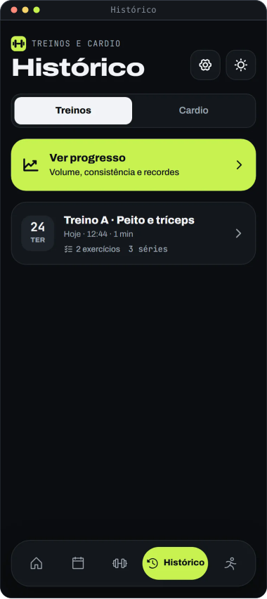<br />
      <sub><b>Histórico</b></sub></td>
    <td align="center" width="33%">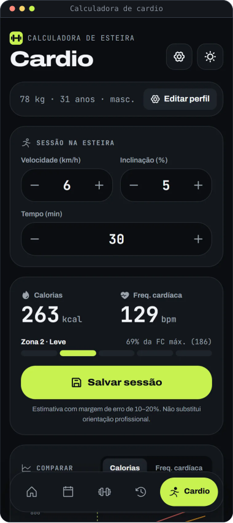<br />
      <sub><b>Calculadora de cardio</b></sub></td>
    <td align="center" width="33%">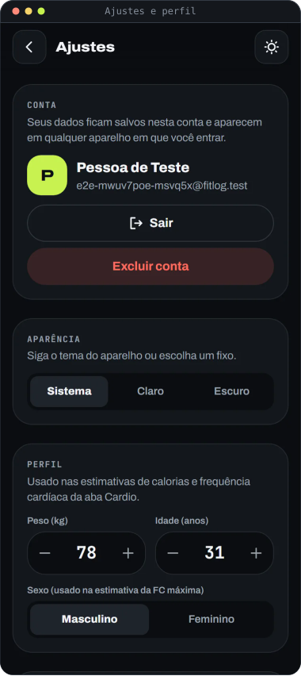<br />
      <sub><b>Ajustes e perfil</b></sub></td>
  </tr>
</table>

</div>

<br />

<div align="center">


</div>

<div align="center">

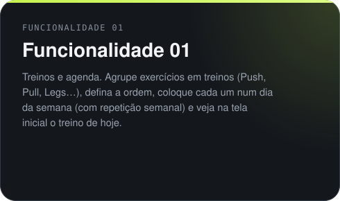
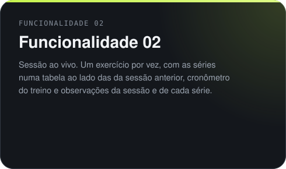
<br />
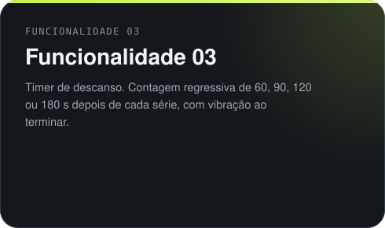
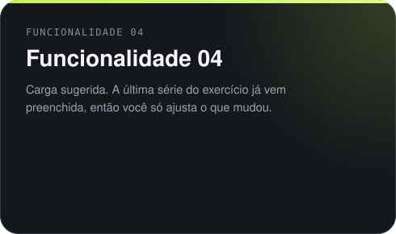
<br />
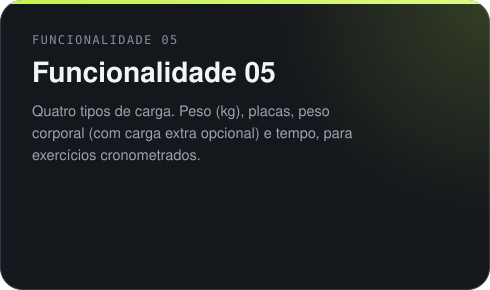
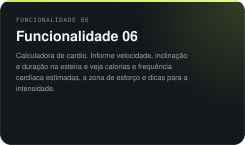
<br />
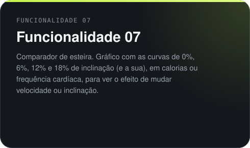
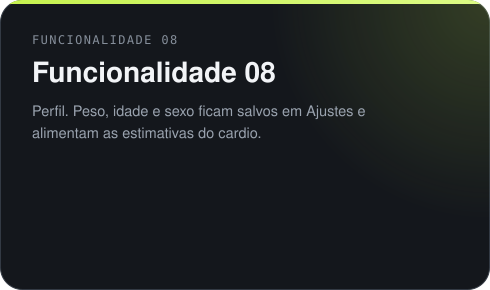
<br />
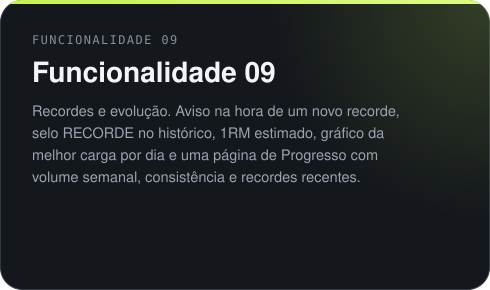
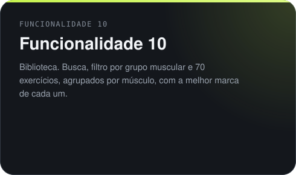
<br />
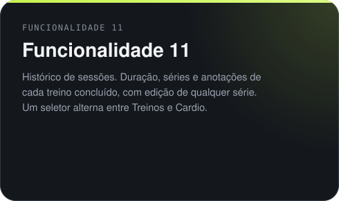
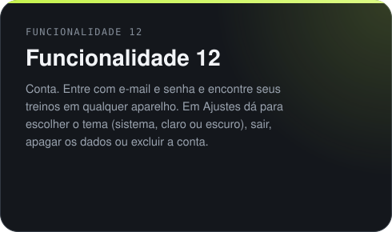

</div>

<br />

<div align="center">

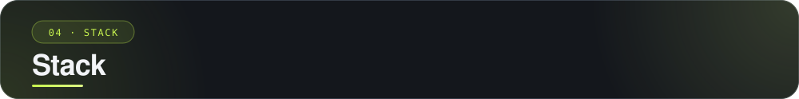

</div>

<div align="center">

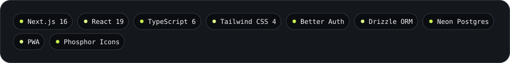

</div>

<br />

<div align="center">

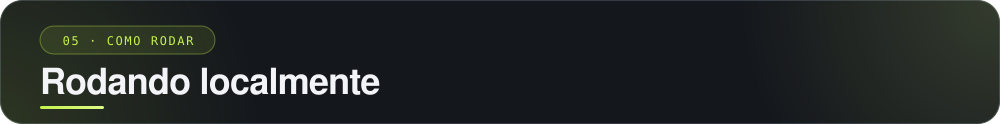

</div>

Requer [Node.js](https://nodejs.org), [pnpm](https://pnpm.io) e um banco Postgres (uma branch `dev` no [Neon](https://neon.tech) serve).

```bash
git clone https://github.com/diegonatalo/fitlog.git
cd fitlog
pnpm install
cp .env.example .env.local   # preencha DATABASE_URL e BETTER_AUTH_SECRET
pnpm db:migrate              # cria as tabelas no banco do .env.local
pnpm dev                     # http://localhost:3000
```

Para testar no celular, abra o endereço de rede que o `pnpm dev` mostra (o IP da sua máquina) na mesma rede Wi-Fi.

| Comando | O que faz |
|---|---|
| `pnpm dev` | Servidor de desenvolvimento |
| `pnpm build` | Checa os tipos e gera o build de produção em `.next/` |
| `pnpm start` | Serve o build de produção (o service worker só roda nele) |
| `pnpm lint` | Roda o ESLint |
| `pnpm test:e2e` | Roda os testes de ponta a ponta (Playwright) |
| `pnpm db:generate` | Gera uma migração SQL em `drizzle/` depois de mudar `lib/db/schema.ts` |
| `pnpm db:migrate` | Aplica as migrações pendentes no banco do `.env.local` |

### 🔑 Variáveis de ambiente

Veja [`.env.example`](.env.example).

| Variável | Descrição | Se não definir |
|---|---|---|
| `DATABASE_URL` | URL do Postgres, com pooler. Em desenvolvimento, use uma branch `dev`, nunca a de produção, num banco com nome terminado em `_dev` (senão o `pnpm dev`, o E2E e as migrações param). | O app não abre |
| `DATABASE_URL_UNPOOLED` | URL sem pooler, usada pelas migrações. | As migrações usam a `DATABASE_URL` |
| `BETTER_AUTH_SECRET` | Segredo que assina os cookies de sessão. Gere com `openssl rand -base64 32`, um por ambiente. | Em produção, o login e o app dão erro |
| `BETTER_AUTH_URL` | Endereço do site em desenvolvimento e nos testes, sem barra no final. Na Vercel não precisa: vale o `SITE_URL`. | Better Auth deduz pela requisição e avisa no log |
| `NEXT_PUBLIC_SITE_URL` | URL pública do site, usada no `canonical`, nas tags Open Graph, no `robots.txt` e no `sitemap.xml`. Sem barra no final. | Usa `https://dn-fitlog.vercel.app` |

### 🧪 Testes

```bash
pnpm test
```

Usa [Vitest](https://vitest.dev). Os testes cobrem a calculadora de cardio, as estatísticas e recordes de carga, a normalização e o schema dos dados, o store (com a persistência simulada), a conversão entre linhas do banco e registros do app, a validação dos formulários de login e os formatadores de data e duração.

Para reexecutar ao salvar: `pnpm test:watch`.

Os testes de ponta a ponta (Playwright, em `e2e/`) abrem o app no Chromium com um banco de verdade. Cada teste cria a própria conta e percorre os fluxos inteiros: criar conta, sair e entrar de novo com os dados no lugar, senha errada, e-mail repetido, uma conta não ver os dados de outra, excluir a conta, montar um treino e registrar uma série, recarregar no meio do treino, apagar todos os dados, e abrir todas as telas sem erros.

```bash
pnpm exec playwright install chromium   # só na primeira vez
pnpm test:e2e                           # gera o build e testa contra o banco do .env.local
```

No CI, o E2E roda contra um Postgres descartável do próprio GitHub Actions, nunca contra o Neon.

<br />

<div align="center">

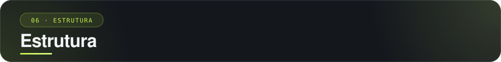

</div>

```text
├── app/          rotas do Next (App Router): landing (/), o app em app/app/ (uma pasta por tela), /entrar, /cadastro,
│                 /privacidade, /termos, a API do Better Auth (api/auth), robots e sitemap
├── components/   interface (log-form, rest-timer, progress-chart, auth-form…), SignedInApp (confere a sessão e carrega
│                 os dados) e StoreProvider (o estado do app, lido com useStore())
├── hooks/        use-workout-store (estado em memória, salvo por Server Actions), use-store, use-theme,
│                 use-theme-choice, use-today, use-now
├── lib/
│   ├── db/           schema do banco (Drizzle) e conexão com o Postgres
│   ├── data/         consultas, Server Actions e conversão entre linhas do banco e registros do app
│   ├── auth.ts       configuração do Better Auth (e-mail e senha)
│   ├── auth-form.ts  validação dos formulários de entrar e criar conta
│   ├── schema.ts     validação dos dados que chegam ao servidor
│   ├── defaults.ts   treinos de exemplo de cada conta nova
│   ├── stats.ts      recordes, 1RM e série histórica
│   ├── dashboard.ts  números da tela inicial
│   ├── progress.ts   volume semanal, consistência e recordes recentes
│   ├── workout-stats.ts  tempo médio, próximo dia na agenda e sessão anterior de cada treino
│   ├── week.ts       a semana da tela inicial
│   ├── cardio.ts     calorias, FC estimada, zonas, comparação e dicas da esteira
│   ├── format.ts     datas, durações e cargas (vírgula decimal)
│   ├── paths.ts      rotas centralizadas
│   └── router.tsx    Link, useNavigate e useParams sobre o roteador do Next
├── types/        modelos e metadados dos tipos de carga
└── proxy.ts      sem cookie de sessão, /app redireciona para /entrar
drizzle/          migrações SQL geradas pelo drizzle-kit
e2e/              testes de ponta a ponta (Playwright)
public/           ícones, manifest, service worker e imagem Open Graph
```
> [!NOTE]
> O estado vive em um único hook (`useWorkoutStore`), servido por Context. Ele começa com os dados
> que o servidor carregou e manda cada mudança para uma Server Action, que confere a sessão e valida a entrada.

<br />

<div align="center">

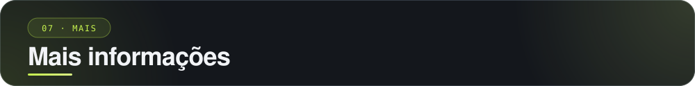

</div>

### 🧩 Como adicionar um novo tipo de carga

1. Inclua o valor em `LoadType` e uma entrada em `LOAD_TYPES`, em `types/index.ts` (rótulo, unidade, passo e se tem repetições).
2. Associe um ícone em `ICONS`, em `components/load-type-toggle.tsx`.
3. Se a unidade tiver formato especial, trate-a em `loadParts`, em `lib/format.ts`.
4. O validador em `lib/schema.ts` já aceita qualquer valor de `LOAD_TYPES`.

### 🔒 Seus dados

Os dados ficam num banco Postgres ([Neon](https://neon.tech)), ligados à sua conta, e aparecem em qualquer aparelho em que você entrar. O login é por e-mail e senha, com [Better Auth](https://www.better-auth.com).

- Toda tabela do app tem chave `(user_id, id)` e cada Server Action confere a sessão antes de ler ou gravar: uma conta nunca alcança as linhas de outra.
- A tela atualiza na hora e a mudança é salva em segundo plano. Se um salvamento falhar, aparece um aviso para recarregar. Fechar a aba no meio de um salvamento pede confirmação.
- O que chega ao servidor é validado antes de ser gravado: dados inválidos são recusados, e nomes, anotações e listas têm tamanho máximo (`LIMITS` em `lib/schema.ts`).
- Login e cadastro têm limite de tentativas por IP, contado no banco para valer em todas as instâncias da Vercel. Todas as páginas saem com cabeçalhos de segurança (`lib/security-headers.ts`), entre eles o que impede abrir o site dentro de um iframe de outro site.
- No navegador ficam só o cookie de sessão e a escolha de tema. O service worker guarda em cache só arquivos estáticos e as páginas públicas, nunca as telas do app.

> [!NOTE]
> Em **Ajustes**, **Apagar todos os dados** limpa a conta, e **Excluir conta** (com a sua senha) apaga a conta e tudo o que está nela.
> Uma cópia dos dados pode ser pedida pelo contato da página de privacidade.

### 🧠 Como funciona

| Conceito | Regra |
|---|---|
| **Recorde** | Uma série é recorde quando a carga supera todas as anteriores do mesmo exercício e tipo de carga. A primeira série nunca conta. |
| **1RM estimado** | Fórmula de Epley (`carga × (1 + reps / 30)`), calculada sobre a melhor série em peso. |
| **Sessão** | Só uma sessão pode estar ativa por vez. Descartar apaga as séries dela, finalizar manda para o histórico. |
| **Arquivar** | Exercício com registros é arquivado ao ser removido. O histórico é mantido e ele pode ser restaurado em Biblioteca → Arquivados. |
| **Calorias do cardio** | Equações metabólicas da ACSM para caminhada (abaixo de 8 km/h) e corrida (a partir de 8 km/h), que estimam o consumo de O₂ pela velocidade e inclinação. O gasto sai de `O₂ × peso × 5 kcal/L × tempo`. |
| **FC estimada** | Esforço como fração da reserva de FC: VO₂máx de Uth–Sørensen e FC de repouso fixa em 70 bpm. FC máxima de Tanaka (`208 − 0,7 × idade`) para homens e de Gulati (`206 − 0,88 × idade`) para mulheres. |
| **Zonas** | Cinco zonas pela reserva de FC: muito leve (<40%), leve, moderada, intensa (≥80%) e máxima (≥90%). |

> [!NOTE]
> As estimativas do cardio são médias populacionais, com margem de erro de 10–20%, e não substituem orientação profissional.

### 🌐 Deploy

Publicado na [Vercel](https://vercel.com) em [dn-fitlog.vercel.app](https://dn-fitlog.vercel.app), com o banco no Neon (integração de Storage da Vercel).

- O script `vercel-build` aplica as migrações pendentes (`drizzle-kit migrate`, pela `DATABASE_URL_UNPOOLED`) e depois gera o build. Só a `main` é publicada (`vercel.json`), então só ela migra o banco de produção.
- Em produção, defina só `BETTER_AUTH_SECRET` (um segredo próprio, diferente do de desenvolvimento). Na Vercel, o endereço do login é o mesmo `SITE_URL` do SEO, e a `DATABASE_URL` vem da integração com o Neon.
- As funções rodam em São Paulo (`gru1`), junto do banco: é escolhido em Settings > Functions > Function Regions, na Vercel, e vale a partir do deploy seguinte. Se mudar, atualize a política de privacidade.
- O `robots.txt` e o `sitemap.xml` vêm de `app/robots.ts` e `app/sitemap.ts`. A landing fica em `/` e o app em `/app`, que pede login (os endereços antigos sem `/app` redirecionam com 308, em `lib/redirects.ts`). O sitemap lista só as páginas públicas: a landing, `/privacidade` e `/termos`.
- Ao trocar de domínio, defina `NEXT_PUBLIC_SITE_URL` (ou altere o valor padrão em `lib/site.ts`).

### 🧭 Próximos passos

- [ ] Testes para as regras do store (hoje os testes cobrem só `lib/`)
- [ ] Séries de aquecimento e *drop sets*
- [ ] Medidas corporais e peso ao longo do tempo
- [ ] Calculadora de cardio para outros equipamentos (bicicleta, elíptico)
- [ ] Sincronização opcional entre dispositivos

> Hoje não há CI, e os dados existem apenas no aparelho onde foram registrados.

### 📄 Créditos e licença

- Distribuído sob a licença **MIT**. Veja o arquivo [LICENSE](LICENSE).

<br />

<div align="center">

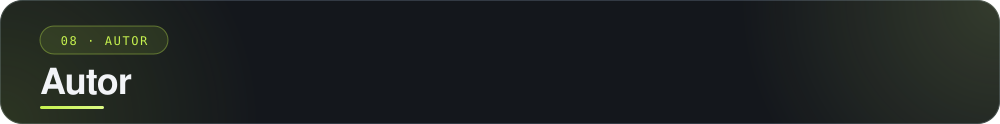

</div>

<div align="center">

<a href="https://diegonatalo.dev"></a>
<a href="https://www.linkedin.com/in/diegonatalo/">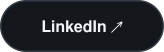</a>
<a href="https://github.com/diegonatalo"></a>

</div>

<br />

<div align="center">

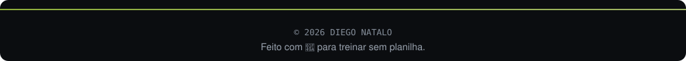

</div>
